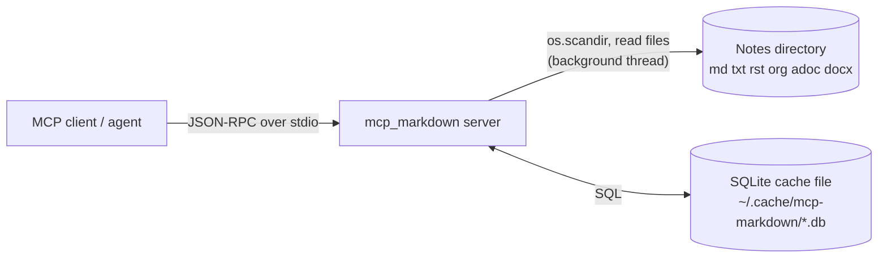
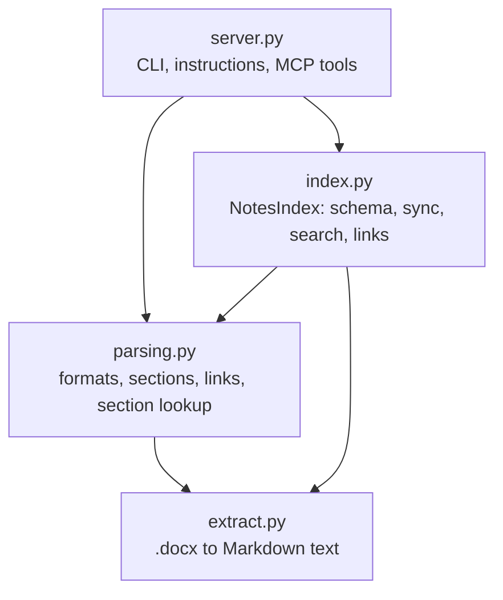
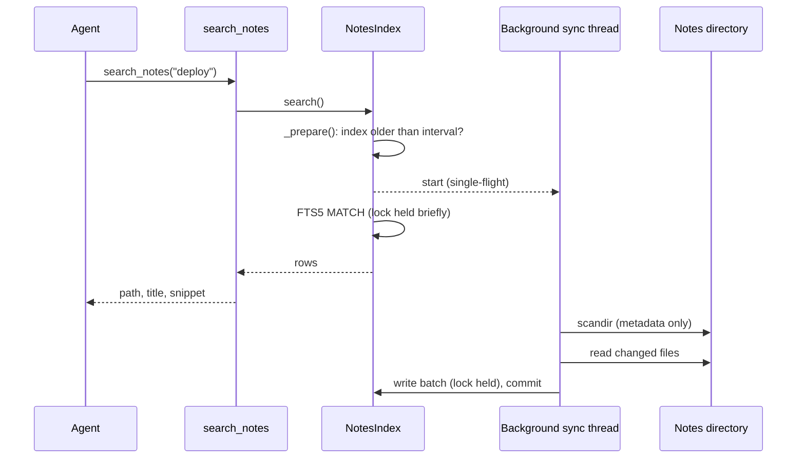
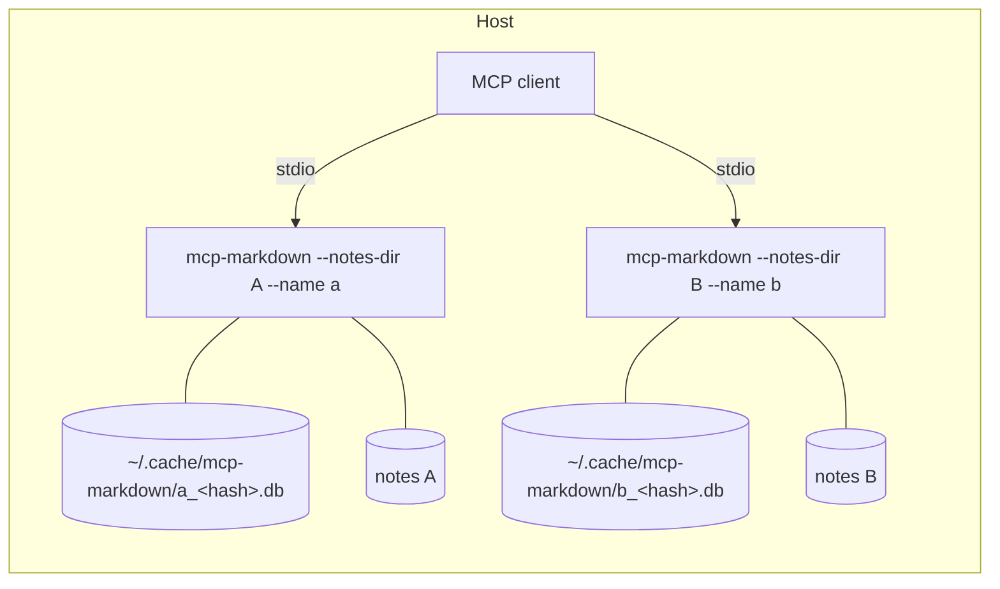

# Architecture (arc42)

Architecture documentation of karpathy-mcp, structured after the [arc42](https://arc42.org/) template.
Requirements are in [requirements.md](requirements.md); usage in [usage.md](usage.md).

## 1. Introduction and goals

karpathy-mcp is an MCP server that gives an AI agent read access to a directory of text notes. It keeps a SQLite
FTS5 index of the notes, so searching and reading do not need to touch the notes directory on every call.

**Quality goals** (in priority order):

1. **Bounded latency on slow file systems:** a tool call never waits for the notes directory.
2. **Small footprint:** standard library plus the `mcp` SDK; one cache file per instance.
3. **Safety:** read-only; no access outside the notes directory through tool arguments.
4. **Agent-friendly output:** compact text, section-level reads, self-describing server instructions.

**Stakeholders:** the owner (runs it, including on a slow Windows host), MCP clients/agents (consume it),
contributors. See [requirements.md](requirements.md#2-stakeholders).

## 2. Architecture constraints

| Constraint                                   | Consequence                                                                                             |
| -------------------------------------------- | ------------------------------------------------------------------------------------------------------- |
| Python 3.10+, official `mcp` SDK (`FastMCP`) | Tools are plain Python functions registered with `@mcp.tool()`.                                         |
| stdio transport                              | stdout carries JSON-RPC. No `print`; logging is configured to stderr in `main()`.                       |
| SQLite with FTS5 from the standard library   | No extra search dependency; the schema follows the original task specification for the two base tables. |
| Slow file access on the target host          | Few file opens, none on the query path; background I/O.                                                 |
| Apache-2.0 license                           | Only compatible dependencies.                                                                           |

## 3. Context and scope

| Neighbour       | Interface                                                                                                       |
| --------------- | --------------------------------------------------------------------------------------------------------------- |
| MCP client      | Tools `search_notes`, `read_note`, `get_outline`, `list_notes`, `get_links`, `sync_notes`; server instructions. |
| Notes directory | Read-only: directory listing, file metadata, file contents.                                                     |
| Cache file      | Read/write SQLite database in WAL mode. Disposable.                                                             |
| Operator        | Command-line options (see [usage.md](usage.md#command-line-options)).                                           |

## 4. Solution strategy

| Goal                   | Approach                                                                                                                                                                 |
| ---------------------- | ------------------------------------------------------------------------------------------------------------------------------------------------------------------------ |
| Bounded latency        | Queries are answered from SQLite only. A **stale-while-revalidate** background sync refreshes the index; directory walk and file reads happen outside the database lock. |
| Few file accesses      | Incremental sync by modification time; note content (including for `read_note`) is served from the index.                                                                |
| Precise, cheap answers | **Section-level index rows**, BM25 with title boost, snippets, outline and section reads.                                                                                |
| Navigation             | A link table (wikilinks and relative links), resolved lazily into outgoing links and backlinks.                                                                          |
| Robustness             | Per-file error isolation; query fallback for invalid FTS5 syntax; schema versioning with automatic rebuild.                                                              |
| Format breadth         | Per-extension parsing specs; binary formats converted to Markdown-like text first, then parsed like Markdown.                                                            |

## 5. Building block view

### Level 1: package `mcp_markdown`

| Module        | Responsibility                                                                                                                                                                                           |
| ------------- | -------------------------------------------------------------------------------------------------------------------------------------------------------------------------------------------------------- |
| `server.py`   | Argument parsing (`parse_args`), default cache path, server instructions, `build_server` (creates the index, registers the six tools, appends the "still indexing" note), `main`.                        |
| `index.py`    | `NotesIndex`: SQLite schema and versioning, directory scan, incremental sync, background sync and locking, search with fallback, listing, text retrieval, link resolution, path containment (`resolve`). |
| `parsing.py`  | Supported extensions, per-format section splitting and link extraction (`parse_note`), `read_note_file`, section lookup (`extract_section`), outline formatting, `--extensions` parsing.                 |
| `extract.py`  | `docx_to_markdown` and `ExtractError`; standard library only (`zipfile`, `xml.etree`).                                                                                                                   |
| `__main__.py` | `python -m mcp_markdown`.                                                                                                                                                                                |

Dependencies point one way: `server` -> `index` -> `parsing` -> `extract`. `parsing` and `extract` contain no I/O
beyond reading the one file they are given and are tested without a database.

### Level 2: the index

Schema (`SCHEMA_VERSION = 2`, stored in `PRAGMA user_version`):

| Object                                          | Content                                                                                                                                                                                                                  |
| ----------------------------------------------- | ------------------------------------------------------------------------------------------------------------------------------------------------------------------------------------------------------------------------ |
| `file_meta(rel_path PK, mtime)`                 | One row per indexed file; the mtime recorded at scan time.                                                                                                                                                               |
| `notes_fts(rel_path UNINDEXED, title, content)` | FTS5, tokenizer `unicode61 remove_diacritics 1`. **One row per section.** `title` is the note title for the first section and `Note > Heading` for the others; `content` is the section text including its heading line. |
| `links(src, target)`                            | Normalized outgoing link targets (lowercase, extension removed). Indexed by `src` and `target`.                                                                                                                          |

If `user_version` is older than the code's version, all tables are dropped and rebuilt from the notes.

Concurrency primitives in `NotesIndex`:

| Primitive       | Purpose                                                                                                                                                |
| --------------- | ------------------------------------------------------------------------------------------------------------------------------------------------------ |
| `lock`          | Guards every use of the single shared SQLite connection (`check_same_thread=False`). Held only for short statements and for the write batch of a sync. |
| `sync_lock`     | Held while a sync runs; makes syncs single-flight. A background sync is started only if the lock can be acquired without waiting.                      |
| `ready` (event) | Set when the first sync attempt (successful or not) has finished.                                                                                      |
| `last_sync`     | Monotonic time of the last finished attempt; drives the staleness check.                                                                               |

## 6. Runtime view

### 6.1 Startup

`build_server` validates `--notes-dir`, opens the database (creating or rebuilding the schema), calls
`maybe_sync()` which starts the first background sync, registers the tools and returns. The MCP handshake does not
wait for indexing.

### 6.2 Search with background refresh

The query that notices staleness gets the old data; the next query sees the new data. Before the first sync has
finished, `_prepare()` also waits up to `startup_wait` (10 s) for the `ready` event.

### 6.3 Synchronization

1. Walk the tree iteratively with `os.scandir`: skip hidden directories and symlinked directories; keep files
   whose extension is selected and whose name does not start with `~$`; skip symlinks to files that resolve
   outside the notes root (logged); record `st_mtime`.
2. Compare with `file_meta`. Changed means: new, or mtime not equal.
3. For each changed file, read (docx: convert) and `parse_note`, with no database lock held. `ExtractError`
   (corrupt file) is logged and the file is indexed as empty; other `OSError`s skip the file for this round.
4. Under the lock, in one transaction: replace the rows of changed files (sections and links), upsert `file_meta`,
   delete rows of vanished files.
5. Always (also after errors): set `last_sync` and the `ready` event, log duration and counts.

### 6.4 Reading a note

`read_note`/`get_outline` normalize the path, check containment with `resolve()`, then take the text from the
index (`get_text`: sections concatenated in insertion order). Only if the note is not indexed yet is the file
read from disk. The section is then cut out with `extract_section` (heading plus deeper-level sections).

### 6.5 Links

`get_links` loads all indexed paths, builds two lookup maps (path without extension, file stem; first path
alphabetically wins on clashes), resolves the note's outgoing targets and finds backlinks by selecting `links` rows
whose target equals the note's path key or stem key and re-checking that they really resolve to this note.

## 7. Deployment view

One operating-system process per notes directory, started by the MCP client.

Install with `pip`/`pipx`/`uv` from a clone. There is no service, daemon, port or configuration file. Each
instance gets its own cache file, named from `--name` and a hash of the notes directory.

## 8. Crosscutting concepts

**Path safety.** Tool paths are normalized (backslashes, `.`/`..`) and resolved against the notes root;
anything resolving outside raises an error before any access. Reads of indexed notes use the normalized relative
path purely as a database key. The scan applies the same containment to symlinked files and does not follow
symlinked directories.

**Logging and stdout.** `logging` is configured to stderr only in `main()`. There is no `print` anywhere in the
package.

**Error handling.** Tools return `Error: ...` strings instead of raising, so the agent can react. Sync errors are
isolated per file; a failing background sync is logged with traceback and never retriggers on every query.

**Format handling.** `parsing.py` maps an extension to a spec (heading pattern, code-fence pattern, whether
frontmatter and links apply). Unknown-heading formats (`txt`, `rst`) become one section. `docx` is converted by
`extract.py` into Markdown-like text (`#` headings), then parsed with a spec that disables frontmatter, fences and
links so that document text cannot create spurious structure; body lines starting with `#` are escaped.

**Titles and sections.** Title = first level-1 heading, else file stem. Headings inside code fences or YAML
frontmatter are not headings. Section handles for `read_note` are heading texts.

**Query handling.** BM25 with weights (`rel_path` 0, `title` 5, `content` 1). Raw query first; on
`sqlite3.OperationalError` retry with each `\w+` token quoted and prefix-matched (`"token"*`, ANDed).

**Persistence.** The database is a cache, safe to delete; version mismatch triggers a rebuild.

**Testing.** `tests/` exercise the index through its public methods against temporary directories, including
concurrency behaviour with gated scans; extraction tests build `.docx` files in memory. See
[development.md](development.md).

## 9. Architecture decisions

| #    | Decision                                                                    | Reasons / alternatives                                                                                                                                                                                                                                           |
| ---- | --------------------------------------------------------------------------- | ---------------------------------------------------------------------------------------------------------------------------------------------------------------------------------------------------------------------------------------------------------------- |
| D-1  | **SQLite FTS5 as the only search engine.**                                  | The owner's host has slow file access, so answering from one file beats grep/open. FTS5 ships with Python; BM25 and snippets come for free. Rejected: embeddings/vector search (keyword-driven technical notes, extra dependencies).                             |
| D-2  | **Section-level rows, base schema unchanged.**                              | Precise hits and cheap section reads. Section name is encoded in the `title` column so the specified columns stay valid. Cost: `list` must group by path; the first section carries the bare note title.                                                         |
| D-3  | **Serve reads from the index.**                                             | Avoids file access on slow disks. Cost: reads are as stale as the index; line endings normalized.                                                                                                                                                                |
| D-4  | **Stale-while-revalidate background sync, single-flight, no timer thread.** | Queries never block; nothing runs while idle; no concurrency beyond one worker. Rejected: timer thread (scans on idle machines), filesystem watchers (extra dependency, unreliable on network drives), directory-mtime pruning (misses edits to existing files). |
| D-5  | **Initial index in the background; bounded wait on first query.**           | Avoids MCP client start-up timeouts on large trees.                                                                                                                                                                                                              |
| D-6  | **Plain-text tool results.**                                                | Compact and readable for models; no schema for the agent to learn. Differs from the original specification, which asked for dicts; the specification's author confirmed those were illustrative (requirements section 9).                                        |
| D-7  | **Lazy link resolution.**                                                   | Links to notes created later resolve without reindexing the source note.                                                                                                                                                                                         |
| D-8  | **Standard-library `.docx` extraction; no PDF.**                            | Keeps the dependency set minimal. PDF would need a third-party parser and has no reliable headings.                                                                                                                                                              |
| D-9  | **Format selection by extension, default all supported.**                   | One flag, predictable. Trade-off: noise from files such as `requirements.txt`.                                                                                                                                                                                   |
| D-10 | **Index versioning with `PRAGMA user_version`, rebuild on mismatch.**       | The index is derived data; migrations would add complexity for no gain.                                                                                                                                                                                          |
| D-11 | **`src/` layout with a package of four modules.**                           | Prevents accidental imports from the working directory and separates parsing (pure) from the index (stateful) from the MCP surface.                                                                                                                              |

## 10. Quality requirements

| Scenario                                                    | Expected behaviour                                                                             |
| ----------------------------------------------------------- | ---------------------------------------------------------------------------------------------- |
| A search arrives while a rescan of a slow share is running. | The search returns from the index at once.                                                     |
| A note is edited.                                           | It is visible after the next rescan: within about one sync interval plus one query.            |
| The agent sends `error: timeout (retry)` as a query.        | Results for the prefix-matched terms; no error.                                                |
| The agent requests `../../etc/passwd`.                      | `Error: Path escapes notes directory`.                                                         |
| A `.docx` is corrupt.                                       | One warning; the note is listed as empty; no repeated parsing.                                 |
| The server starts on 1000 notes.                            | The handshake completes immediately; early searches may carry the "indexing in progress" note. |

Quality requirement IDs and the tests that verify them: [requirements.md, section 5](requirements.md#5-quality-requirements).

## 11. Risks and technical debt

| ID   | Risk / debt                                                                                                                                                                                      | Impact                                            | Possible remedy                                                                                                                                                                         |
| ---- | ------------------------------------------------------------------------------------------------------------------------------------------------------------------------------------------------ | ------------------------------------------------- | --------------------------------------------------------------------------------------------------------------------------------------------------------------------------------------- |
| R-4  | Each rescan walks the whole tree. Cost on the slow host is unmeasured.                                                                                                                           | Background I/O load on slow disks.                | Use the logged durations; adaptive interval; larger `--sync-interval`.                                                                                                                  |
| R-5  | Reads and searches can be one interval stale; deleted notes stay readable until the next sync.                                                                                                   | Agent sees outdated content.                      | Acceptable by requirement; `sync_notes` for immediate refresh.                                                                                                                          |
| R-6  | Default "all extensions" can index noise and duplicates (`a.md` and `a.docx`).                                                                                                                   | Cluttered results; ambiguous links.               | `--exclude` globs; narrower `--extensions`. A fixed skip list (`requirements.txt`, `license.txt`, `todo.txt`) was suggested in review but not adopted: such names can be genuine notes. |
| R-7  | Keyword-only search; no synonyms.                                                                                                                                                                | Missed notes when the agent uses different words. | Agent retries (instructions say so); semantic search only if needed.                                                                                                                    |
| R-8  | `.docx` parsing uses `xml.etree` on files from the notes directory; expat limits entity expansion but the parser is not hardened, and a size limit (64 MB per XML part) is the only other guard. | Untrusted documents could consume resources.      | `defusedxml` if untrusted input matters.                                                                                                                                                |
| R-9  | FastMCP (mcp 1.27.2) calls synchronous tool functions inline on the event loop, so the first-query wait (up to 10 s) blocks the server loop meanwhile.                                           | Only relevant before the first index completes.   | Make tools async and wait without blocking.                                                                                                                                             |
| R-10 | Verified only by unit tests and in-process tool calls; not yet exercised with a real MCP client over stdio, nor on Windows.                                                                      | Integration surprises.                            | Manual test with an MCP client; CI on multiple platforms (no CI is configured yet).                                                                                                     |

## 12. Glossary

| Term                   | Meaning                                                                                                                                    |
| ---------------------- | ------------------------------------------------------------------------------------------------------------------------------------------ |
| MCP                    | Model Context Protocol; the protocol agents use to call tools on servers.                                                                  |
| FTS5                   | SQLite's full-text search extension.                                                                                                       |
| BM25                   | Ranking function used by FTS5 (`bm25()`); lower scores rank better, so queries order ascending.                                            |
| Section                | The text from one heading up to the next heading (any level); the unit of indexing. A section read also includes deeper-level subsections. |
| Note                   | One indexed file.                                                                                                                          |
| Stale-while-revalidate | Answer from possibly outdated data now, refresh it in the background for later.                                                            |
| Sync / rescan          | Reconciling the index with the notes directory.                                                                                            |
| Wikilink               | `[[Note name]]`-style link, optionally `[[name\|alias]]` or `[[name#section]]`.                                                            |
| Backlink               | A link from another note that points to this note.                                                                                         |
