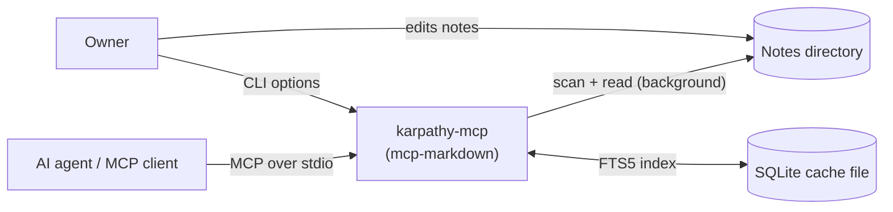

# Requirements (req42)

Requirements for karpathy-mcp, structured after the [req42](https://req42.de/) template. The original task
specification is preserved in [original-task-spec.md](original-task-spec.md); section 9 records where the
implementation differs from it. Design is described in [architecture.md](architecture.md).

## 1. Vision and goals

### 1.1 Vision

An AI agent can use a personal or team knowledge base of text notes (a Karpathy-style Markdown wiki, a mirror of
a wiki, a folder of documents) as a reliable source of knowledge: it finds the relevant note quickly, reads only
the part it needs, and follows links between notes, even when file access on the host is slow.

### 1.2 Goals

| ID | Goal |
|----|------|
| G-1 | Give MCP clients fast, ranked keyword search over a directory of notes. |
| G-2 | Keep the cost of each agent interaction small in tokens and in file-system accesses. |
| G-3 | Let the agent navigate a wiki: outlines, section reads, links and backlinks. |
| G-4 | Be trivial to run: one command, one cache file, no services, minimal dependencies. |
| G-5 | Allow many independent instances, one per notes directory. |
| G-6 | Never modify or expose anything outside the notes directory. |

### 1.3 Non-goals

- Semantic or vector search; question answering; summarization.
- Editing, creating or deleting notes (the server is read-only).
- A multi-user network service, authentication, or remote file systems access beyond what the OS provides.
- OCR, and formats such as PDF, `.doc`, HTML, Notion/Confluence exports (see section 8).

## 2. Stakeholders

| Stakeholder | Interest |
|-------------|----------|
| Owner / primary user (Simon Hartmann) | Wants an agent attached to their notes; runs it on machines with slow file access (antivirus, network drives), including Windows. |
| AI agent / MCP client | Consumes the tools. Needs predictable, compact, self-explanatory output and graceful errors. |
| Contributors | Need a small, understandable code base with tests and documentation ([CONTRIBUTING.md](../CONTRIBUTING.md)). |

## 3. Scope and context

In scope: indexing and searching text notes, section and link navigation, the CLI, packaging, documentation.
Outside the system: the MCP client, the agent's model, the editing of notes.

## 4. Functional requirements

Status: **Done** = implemented and covered by tests; **Partial** = implemented with limits noted.

| ID | Requirement | Status |
|----|-------------|--------|
| FR-01 | The server takes the notes directory with `--notes-dir`; the display name with `--name`; the index location with `--cache-dir` (default `~/.cache/mcp-markdown/`). | Done |
| FR-02 | The server indexes notes into one SQLite database using FTS5 with `unicode61 remove_diacritics 1`, WAL journal mode and `synchronous = NORMAL`. | Done |
| FR-03 | Synchronization is incremental: only files with a changed modification time are read; files removed from disk are removed from the index. | Done |
| FR-04 | The index is refreshed automatically in the background at most every `--sync-interval` seconds and on request (`sync_notes`). | Done |
| FR-05 | Startup must not block on indexing. | Done |
| FR-06 | `search_notes` returns ranked matches with snippets, at section granularity. | Done |
| FR-07 | Search queries that are not valid FTS5 syntax still return results (retry with quoted, prefix-matched terms). | Done |
| FR-08 | `read_note` returns a whole note or one heading section including subsections. | Done |
| FR-09 | `get_outline` lists a note's headings with section sizes. | Done |
| FR-10 | `list_notes` lists indexed notes, filterable by path prefix. | Done |
| FR-11 | `get_links` shows outgoing links, unresolved links and backlinks (wikilinks and relative links in Markdown-family notes). | Done |
| FR-12 | Formats are selectable with `--extensions`: Markdown family, `txt`, `text`, `rst`, `org`, `adoc`, `asciidoc`, `docx`. Headed formats are split into sections. | Done |
| FR-13 | The server sends usage instructions to the agent and supports `--description` for per-instance context. | Done |
| FR-14 | Unreadable or corrupt files do not stop synchronization; corrupt `.docx` files are not re-parsed on every sync. | Done |
| FR-15 | An index created by an older layout is rebuilt automatically. | Done |
| FR-16 | Several server instances can run side by side with different notes directories; their default cache files never collide. | Done |

## 5. Quality requirements

| ID | Quality | Requirement | Verified by |
|----|---------|-------------|-------------|
| Q-1 | Performance | A search must not wait for a rescan, regardless of how slow the file system is. | `test_search_does_not_wait_for_rescan` |
| Q-2 | Performance | Unchanged files are not read again during a rescan. | `test_unchanged_files_not_reread` |
| Q-3 | Performance | Reading an indexed note or section requires no file access. | `test_get_text_served_from_index` |
| Q-4 | Efficiency | Typical tool answers should be small: snippets of about 24 tokens, section reads instead of whole notes, outlines before reads. | design; manual |
| Q-5 | Security | Neither a tool argument nor the scan may reach a file outside the notes directory (`..`, absolute paths, symlinks). | `test_resolve_rejects_traversal`, `test_resolve_rejects_symlink_escape`, `test_scan_skips_symlinks_outside_root`, `test_scan_does_not_follow_symlinked_directories` |
| Q-6 | Robustness | Invalid UTF-8 is replaced, not fatal; one broken file never aborts a sync; a failed background sync does not retrigger on every query. | `test_invalid_utf8_replaced`, `test_failed_sync_does_not_retrigger_or_block`, `test_corrupt_docx_indexed_empty_and_not_retried` |
| Q-7 | Protocol safety | Nothing but MCP traffic may be written to stdout. Logging goes to stderr. | design (no `print`); manual |
| Q-8 | Portability | Linux, macOS and Windows; Python 3.10+. | developed and tested on Linux with Python 3.12 only |
| Q-9 | Footprint | Only `mcp` as third-party runtime dependency; one cache file per instance. | `pyproject.toml` |
| Q-10 | Maintainability | Automated tests for index, parsing, extraction; documented architecture. | `tests/`, `docs/` |

## 6. Constraints

| ID | Constraint |
|----|------------|
| C-1 | Python 3.10 or newer; the official `mcp` SDK (`FastMCP`). |
| C-2 | SQLite from the standard library with FTS5 available. |
| C-3 | Transport is stdio; stdout is reserved for JSON-RPC. |
| C-4 | The schema's two base tables (`file_meta`, `notes_fts`) follow the original specification. |
| C-5 | License: Apache-2.0. |

## 7. Assumptions and risks

- Notes are text files edited by a person or an agent outside this server; a delay of about a minute before edits
  show up is acceptable (confirmed by the owner).
- A notes directory holds roughly 100-1000 files (owner's estimate for the slow machine). Much larger trees may
  need an adaptive rescan interval.
- The owner's slow-disk problem is assumed to be dominated by file opens, not directory listing; this has not
  been measured yet (the sync duration is logged for that purpose).
- Risks and technical debt are tracked in [architecture.md, section 11](architecture.md#11-risks-and-technical-debt).

## 8. Possible future requirements

Not committed, listed to record decisions taken so far.

- `--exclude` globs to keep noisy files (`requirements.txt`, logs) out of the index.
- Adaptive rescan interval derived from the measured scan duration.
- PDF support as an optional dependency, one section per page. Scanned PDFs would stay empty (no OCR).
- Optional write tools behind an explicit flag, for agents that maintain the wiki.
- `--output-format json` for programmatic consumers of the tools (not needed by agents).
- Semantic search, only if keyword search proves insufficient in practice.

## 9. Relationship to the original task specification

The implementation was first built from a short version of the specification and later compared with the
extended one. Differences that exist today:

| Original specification | Current implementation |
|------------------------|------------------------|
| `get_note_outline(rel_path)` returns a dict with H1-H3 headings | `get_outline(path)` returns text with all heading levels and section sizes |
| `refresh_index()` returns a dict `added/updated/deleted/skipped` | `sync_notes()` returns text `added/updated/removed/total` |
| `search_notes(query, limit=5)` returns `list[dict]` with `path,title,snippet,score`; snippet markers `>>>`/`<<<` | text result; no score; markers `**` |
| Parameter name `rel_path` | `path` |
| Query sanitizing: always strip punctuation, AND of prefix terms | Raw FTS5 syntax first; the specified prefix-AND query is used as the fallback on a syntax error |
| One row per file | One row per section (same columns) |
| Index built synchronously at start | Built in the background |
| Only `.md` files | Configurable extensions, default all supported |
| Single `server.py` | Package `mcp_markdown` under `src/` |

The specification's author confirmed that the `list[dict]` return types and the tool names were illustrative; the plain-text results and the shorter names (`get_outline`, `sync_notes`, ...) are kept.
